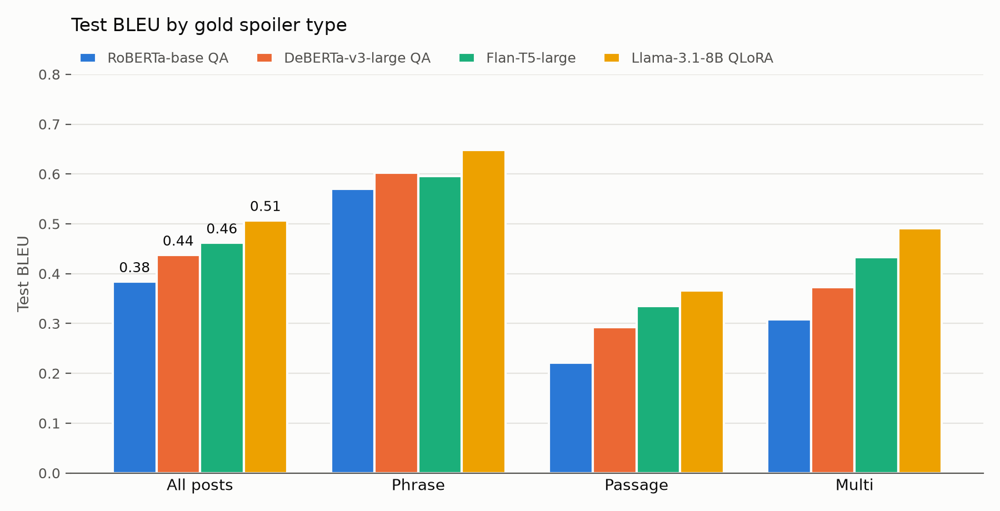

# Extension 1: does a bigger or different model beat the strong baseline?

## The extension

Our Milestone 2 strong baseline follows the shared-task setup:
- a RoBERTa-base reader (125M parameters) extracts the spoiler as a span of the article;
- a separate RoBERTa-base classifier decides whether it is a phrase, a passage or a multi-part spoiler.

It reaches 0.384 test BLEU, and its errors point to two weaknesses:
- **Passage spoilers** (0.22 BLEU; a fifth of them score zero).
- **Wrong spoiler types.** A wrong type costs about 0.025 BLEU overall, because the type decides how the spoiler is decoded.

This extension asks whether **model scale and model family** fix these. We train three models of increasing size, each from a different family, and compare them with the strong baseline:
1. **DeBERTa-v3-large** (435M) as a drop-in, stronger extractive reader, keeping everything else fixed.
2. **Flan-T5-large** (783M), a sequence-to-sequence model that *writes* the type and the spoiler in one output (`multi: bacon | eggs | toast`), so it needs no separate classifier and isn't limited to one contiguous span.
3. **Llama-3.1-8B-Instruct** (8B), an instruction-tuned LLM fine-tuned with QLoRA: a 4-bit frozen base plus 42M trainable adapter weights, so it fits on one 24 GB GPU. It answers in a `type: … / spoiler: …` format. It is also the fine-tuned anchor for the final milestone, where we compare against *prompted* LLMs.

To keep the comparison fair:
- Every model uses the same splits, the same official metrics (`score.py`), and dev-only model selection.
- Every model gets a **three-point learning-rate sweep**, and the best epoch of each run is chosen by dev BLEU.
- The two extractive readers share the same type predictions, so their difference is the reader alone.
- For every model we also decode the test set with the **gold types** given (forced as the start of the output for the generative models). The gap to the end-to-end score separates type errors from extraction errors.
- A **paired bootstrap test** (10,000 resamples of the 1,000 test posts) tells whether each model's BLEU difference to the baseline, overall and per type, is larger than chance.

## How to use the code

See `README.md`. In short, on the L4 VM:
1. `pip install -r requirements.txt`
2. Accept the Llama license and run `hf auth login`.
3. Run `bash run-all.sh` inside tmux.

The three sweeps take about 25 hours of L4 time: DeBERTa ≈ 3.5 h, Flan-T5 ≈ 9 h, Llama ≈ 12.5 h. That is more than the VM's 24-hour limit, so run them in two sessions:
- `bash run-all.sh 1-deberta-qa.ipynb 2-flan-t5.ipynb`
- `bash run-all.sh 3-llama-qlora.ipynb 4-compare.ipynb`

Learning rates that already finished are skipped. `4-compare.ipynb` writes the tables below to `output/comparison-*.md` and needs no GPU. Each notebook can also be run on its own, and `SMOKE=1` gives a few-minute test run.

| | DeBERTa-v3-large QA | Flan-T5-large | Llama-3.1-8B-Instruct QLoRA |
|---|---|---|---|
| Hugging Face model | `deepset/deberta-v3-large-squad2` | `google/flan-t5-large` | `meta-llama/Llama-3.1-8B-Instruct` |
| Output | span(s) of the article | `type: spoiler \| spoiler` | `type: …` + one `spoiler: …` line per item |
| Spoiler type from | Milestone 2 RoBERTa classifier | the model's own output | the model's own output |
| Input | post + 384-token windows, overlap 128 | `question: post context: article`, ≤ 1,024 tokens | chat prompt with post + article (≤ 1,600 article tokens) |
| Learning rates | 5e-6 / 1e-5 / 2e-5 | 5e-5 / 1e-4 / 3e-4 | 5e-5 / 1e-4 / 2e-4 |
| Batch (× accumulation), epochs | 8 × 2, 3 | 4 × 4, 5 | 1 × 16, 2 |
| Optimizer, schedule | AdamW (wd 0.01), linear, 10% warmup | AdamW (wd 0.01), linear, 10% warmup | paged 8-bit AdamW, cosine, 3% warmup |
| Other | bf16 | bf16, gradient checkpointing, beam search (4) | NF4 4-bit base, LoRA r 16 / α 32 / dropout 0.05 on all linear layers, loss on the answer only, greedy decoding |
| Best epoch by | dev BLEU (gold types) | dev BLEU (end to end) | dev BLEU (end to end) |
| Chosen learning rate | 1e-5 | 3e-4 | 2e-4 |
| Decoding chosen on dev | max answer tokens: phrase 16 / passage 64 / multi 24; 5 spans for multi | — | — |
| Training time per learning rate (L4) | 66 min | ≈ 2.8 h | ≈ 4.0 h |

Training posts whose spoiler lies entirely beyond the input cut-off are left out of training: about 3% for Flan-T5 and under 1% for Llama.

## Results

From the L4 runs of 2026-11-07/08. The tables come from `output/comparison-*.md`, written by `4-compare.ipynb`.

**Test set (1,000 posts):**

| System | Size | BLEU | Phrase | Passage | Multi | METEOR | BERTScore | Type bal. acc. | BLEU (gold types) |
|---|---|---|---|---|---|---|---|---|---|
| Simple baseline (first sentence) | — | 0.0497 | 0.0323 | 0.0816 | 0.0182 | 0.1281 | 0.8478 | 0.3333 | — |
| RoBERTa-base QA (M2 strong baseline) | 125M | 0.3843 | 0.5704 | 0.2219 | 0.3080 | 0.4182 | 0.9140 | 0.6920 | 0.4091 |
| DeBERTa-v3-large QA | 435M | 0.4377 | 0.6026 | 0.2925 | 0.3731 | 0.4885 | 0.9234 | 0.6920 | 0.4818 |
| Flan-T5-large | 783M | 0.4621 | 0.5955 | 0.3346 | 0.4332 | 0.4252 | 0.9253 | 0.7473 | 0.5141 |
| **Llama-3.1-8B QLoRA** | 8B (42M trained) | **0.5071** | **0.6481** | **0.3659** | **0.4911** | **0.5079** | **0.9337** | **0.7585** | **0.5607** |
| *Reference:* SemEval organizer baseline (DeBERTa-large QA) | | 0.40 | 0.65 | 0.24 | 0.12 | | | | |
| *Reference:* best SemEval-2023 system | | 0.48 | 0.66 | 0.32 | 0.44 | | | 0.74 | |

**Learning-rate sweeps** (best dev BLEU per learning rate, with the epoch it came from; the QA models' dev BLEU uses gold types, the generative models' is end to end, so compare within a row):

| Model | lr 1 | lr 2 | lr 3 | Training time per lr |
|---|---|---|---|---|
| RoBERTa-base QA (M2) | 1e-5: **0.4434** (ep. 2) | 3e-5: 0.4432 (ep. 3) | 5e-5: 0.4272 (ep. 2) | 9 min |
| DeBERTa-v3-large QA | 5e-6: 0.4857 (ep. 3) | 1e-5: **0.4964** (ep. 3) | 2e-5: 0.4887 (ep. 3) | 66 min |
| Flan-T5-large | 5e-5: 0.4157 (ep. 4) | 1e-4: 0.4262 (ep. 5) | 3e-4: **0.4505** (ep. 5) | 166–171 min |
| Llama-3.1-8B QLoRA | 5e-5: 0.4905 (ep. 2) | 1e-4: 0.5018 (ep. 2) | 2e-4: **0.5038** (ep. 2) | 239–243 min |

**Paired bootstrap vs the strong baseline** (test BLEU difference, with its 95% interval):

| Model | All posts | Phrase | Passage | Multi |
|---|---|---|---|---|
| DeBERTa-v3-large QA | +0.053 [0.031, 0.076] | +0.032 [−0.004, 0.070] | +0.071 [0.034, 0.108] | +0.065 [0.033, 0.099] |
| Flan-T5-large | +0.078 [0.052, 0.104] | +0.025 [−0.016, 0.066] | +0.113 [0.071, 0.156] | +0.125 [0.073, 0.177] |
| Llama-3.1-8B QLoRA | +0.123 [0.096, 0.149] | +0.078 [0.037, 0.119] | +0.144 [0.103, 0.186] | +0.183 [0.121, 0.244] |

Every interval excludes 0 except phrase for DeBERTa and Flan-T5. Those two phrase gains could be chance.

**Where the errors are** (test; from `output/comparison-errors.md`):

| System | Wrong type (of 1,000) | Zero-BLEU posts: phrase / passage / multi / all | Spoiler items copied word for word from the article | Items per *multi* prediction |
|---|---|---|---|---|
| RoBERTa-base QA (M2) | 302 | 16% / 22% / 7% / 17% | 100% | always 5 |
| DeBERTa-v3-large QA | 302 | 15% / 17% / 4% / 14% | 100% | always 5 |
| Flan-T5-large | 229 | 17% / 14% / 5% / 14% | 93.6% | 1–11, mostly 5 (55) or 2 (29) |
| Llama-3.1-8B QLoRA | 225 | 13% / 12% / 3% / 11% | 98.9% | 1–10, mostly 5 (80) or 2 (45) |

### What the numbers say

**Bigger models help, and the gains are real.**
- All three models beat the strong baseline overall. Test BLEU rises with model size: 0.384 → 0.438 → 0.462 → 0.507.
- Every overall difference is far outside the bootstrap noise.
- Llama-3.1-8B with QLoRA reaches **0.507 BLEU, above the best SemEval-2023 system (0.48)**. It is clearly above that system on passage (0.37 vs 0.32) and multi (0.49 vs 0.44), and about level on phrase (0.65 vs 0.66).
- DeBERTa-v3-large, the same model family as the organizers' baseline, scores 0.438 against the organizers' 0.40.
  - The difference comes from multi (0.37 vs 0.12), thanks to our per-span training and top-k decoding.
  - On phrase it is lower (0.60 vs 0.65), partly because of the classifier's wrong types.

**The gains are largest where the baseline was weakest.**
- Passage gains: +0.07 (DeBERTa), +0.11 (Flan-T5), +0.14 (Llama).
- Multi gains: +0.07, +0.13, +0.18.
- For Llama, the share of passage posts that score zero falls from 22% to 12%.
- Phrase spoilers improve much less. Only Llama's phrase gain is clearly more than chance.
  - These spoilers are a few words long, so the small reader already finds most of them.
  - Many remaining misses come from the type: a phrase post labeled *passage* (the most common confusion for every model) is decoded as a long span.

**The reader alone is worth +0.05 BLEU.** DeBERTa and RoBERTa share every type prediction, so their difference comes only from the stronger reader. It is significant for passage and multi.

**Letting the model write the type works better than the separate classifier.**
- Flan-T5 and Llama predict the type themselves. They reach 0.747 and 0.759 balanced accuracy, against 0.692 for the RoBERTa classifier and 0.74 for the best SemEval type classifier.
- They get 229 and 225 types wrong, against 302.
- Their *multi* labels are much more precise: 0.82 (Flan-T5) and 0.78 (Llama), against 0.57 for the classifier. So fewer short spoilers get decoded as five spans.
- They also decide how many items a multi spoiler has, mostly 5 or 2. The extractive models always output the 5 spans tuned on dev.
- Their multi gain isn't only about types. Even with the gold type given, they score 0.44 (Flan-T5) and 0.53 (Llama) on multi, against 0.38 for DeBERTa.
- **Wrong types still cost more as the reader gets better.** The gap between gold-type and end-to-end BLEU is 0.025 (RoBERTa), 0.044 (DeBERTa), 0.052 (Flan-T5) and 0.054 (Llama). Phrase vs passage remains the most common confusion for every model.

**The generative models mostly copy.**
- 98.9% of Llama's spoiler items and 93.6% of Flan-T5's appear word for word in the article. So both learned to behave like extractors, although nothing forces them to.
- Flan-T5 paraphrases or merges text more often. Snapping such outputs to the nearest article span is a cheap fix to try.

**Learning rates.**
- DeBERTa and Llama are insensitive to the learning rate: within 0.011 and 0.013 dev BLEU.
- Flan-T5 is more sensitive (0.416–0.451) and does best with the highest learning rate.
- For all three models, the chosen run's dev BLEU is still rising at the last epoch. Longer training may help, and is a natural parameter sweep for the final report.

**Cost.**
- Each learning rate takes 9 min (RoBERTa), 66 min (DeBERTa), about 2.8 h (Flan-T5) and about 4 h (Llama) on one L4.
- Llama's +0.12 BLEU over the baseline costs about 28 times the training time, plus slower generation at prediction time and a gated license.
- DeBERTa gets about 40% of Llama's gain for about a quarter of its training time.

**A caveat to test in the final milestone.**
- Llama 3.1 was pretrained on web data up to late 2023. The Webis corpus (2022) and many of the news articles are public, so part of its advantage could be memorization.
- The planned **closed-book probe** (the post only, without the article) will show how much it already knows.
- The generative models also see less of long articles: 1,600 article tokens for Llama and 1,024 input tokens for Flan-T5, while the extractive readers slide over the whole article.

## References

- He, P., Gao, J., Chen, W. (2023). *DeBERTaV3: Improving DeBERTa using ELECTRA-Style Pre-Training with Gradient-Disentangled Embedding Sharing.* ICLR. https://arxiv.org/abs/2111.09543
- Raffel, C., et al. (2020). *Exploring the Limits of Transfer Learning with a Unified Text-to-Text Transformer.* JMLR. https://arxiv.org/abs/1910.10683
- Chung, H. W., et al. (2024). *Scaling Instruction-Finetuned Language Models* (Flan-T5). JMLR. https://arxiv.org/abs/2210.11416
- Grattafiori, A., et al. (2024). *The Llama 3 Herd of Models.* https://arxiv.org/abs/2407.21783
- Hu, E. J., et al. (2022). *LoRA: Low-Rank Adaptation of Large Language Models.* ICLR. https://arxiv.org/abs/2106.09685
- Dettmers, T., Pagnoni, A., Holtzman, A., Zettlemoyer, L. (2023). *QLoRA: Efficient Finetuning of Quantized LLMs.* NeurIPS. https://arxiv.org/abs/2305.14314
- Koehn, P. (2004). *Statistical Significance Tests for Machine Translation Evaluation.* EMNLP. https://aclanthology.org/W04-3250/
- Hagen, M., Fröbe, M., Jurk, A., Potthast, M. (2022). *Clickbait Spoiling via Question Answering and Passage Retrieval.* ACL. https://aclanthology.org/2022.acl-long.484/
- Fröbe, M., et al. (2023). *SemEval-2023 Task 5: Clickbait Spoiling.* SemEval. https://aclanthology.org/2023.semeval-1.312/
