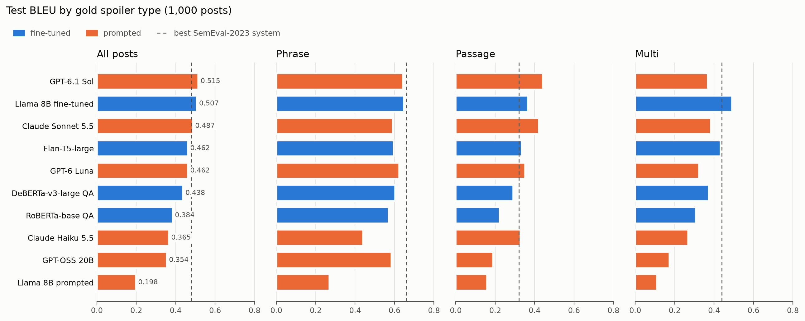
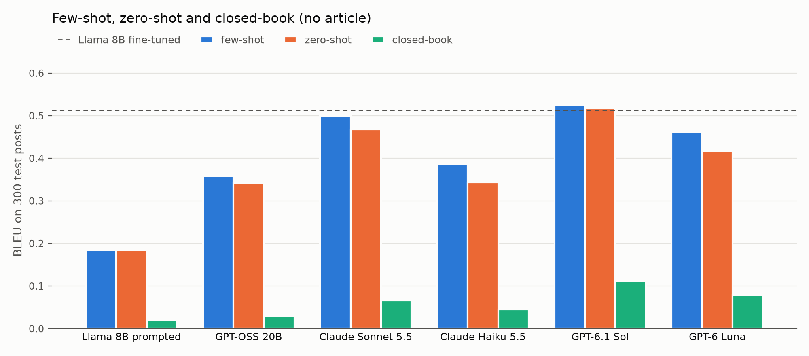
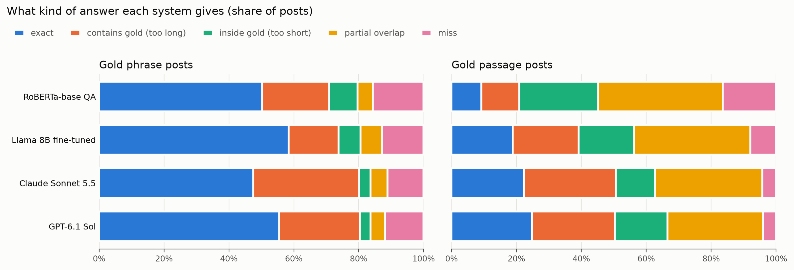
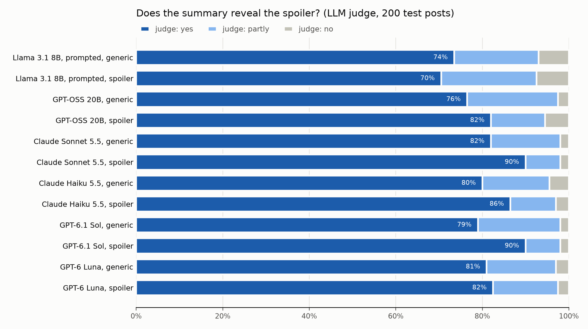

# Extension 2: can prompted LLMs replace fine-tuning?

## The extension

Milestone 3 showed that bigger fine-tuned models spoil clickbait better. Our best one is Llama 3.1 8B fine-tuned with QLoRA: 0.507 test BLEU, above the best SemEval-2023 system (0.48). But fine-tuning needs labeled data, a GPU and about 12 GPU-hours for a learning-rate sweep.

This extension asks whether **large language models used with a prompt only, with no training**, can do the same job. It also asks three follow-up questions:
1. **How close do prompted models come, and on which spoiler types?** We prompt six models of different sizes and vendors with the same prompt and compare them with all our fine-tuned models on the SemEval-2023 test set.
2. **What does fine-tuning change?** Llama 3.1 8B Instruct is the one model we run both ways, prompted and fine-tuned.
3. **Do the models already know the answers?** The Webis corpus and its news articles are public, so a model may have seen them during pretraining. A **closed-book probe** gives the model the post without the article.

As an extra, we asked the same models for **two-sentence summaries** of the articles, to see whether a summary gives the spoiler away. The demo will show such a summary next to the spoiler.

**The models.** The cloud models come in price-matched pairs: Sonnet 5.5 and GPT-6.1 Sol cost $2 / $10 per million input / output tokens, Haiku 5.5 and GPT-6 Luna $0.10 / $0.50.

| Model | Runs on | Settings |
|---|---|---|
| Llama 3.1 8B Instruct | the M4 Pro Mac, Ollama, 4-bit (Q4_K_M) | temperature 0. The base model we fine-tuned in Milestone 3. |
| GPT-OSS 20B (21B mixture of experts) | the Mac, Ollama, 4-bit (MXFP4) | low reasoning effort, temperature 0 |
| Claude Sonnet 5.5, Claude Haiku 5.5 | Anthropic API | adaptive thinking at low effort; the worked examples prompt-cached |
| GPT-6.1 Sol, GPT-6 Luna | OpenAI Responses API | low reasoning effort |

**The prompt** (`code/spoilerqa/llm.py`) is the same for every model:
- **A system prompt.** It explains the three spoiler types and asks for the spoiler **copied word for word from the article**, using the shortest text that fully answers the post.
- ***k* worked examples** from the training set, as earlier turns of the conversation. These are six fixed posts with short, clean articles, two per type.
- **The post and the article** (title and paragraphs), cut at 24,000 characters. The cut affects 3 of the 1,000 test posts.

Every model answers in JSON, `{"type": ..., "spoilers": [...]}`, which each provider's structured-output option enforces. Each predicted spoiler is then **snapped** onto the article's own text: an exact match ignoring case and spacing, or failing that, the closest span with a fuzzy-match score of at least 80/100.

**The experiments.**
1. **Parameter sweep:** *k* = 0, 3 and 6 worked examples on a stratified sample of 200 dev posts. The best *k* per model, by dev BLEU, is used on test.
2. **Main run:** the full test set (1,000 posts) with each model's best *k*.
3. **Probes** on a stratified sample of 300 test posts:
   - *zero-shot*: the article but no worked examples;
   - *closed-book*: the post only, no article, and no snapping.
4. **Comparison with the fine-tuned models** (Milestones 2 and 3), using the official metrics (`code/score.py`). A paired bootstrap test (10,000 resamples) decides which differences are real. Each table of tests uses the Holm–Bonferroni correction for multiple tests.
5. **Per-type error analysis** of the strong baseline, the fine-tuned Llama and the two best prompted models.
6. **Summaries:** 200 test posts × 6 models × 2 kinds of summary. An LLM judge checks each one, and a sample is set aside for human rating.

## How to use the code

All code is in `code/`; run the notebooks from there. Outputs go to `output/`.

| Notebook | What it does | Needs | Time, cost |
|---|---|---|---|
| `1-prompted-llms.ipynb` | asks all six models (dev sweep, test run, probes), snaps, scores with `score.py` | Ollama with `llama3.1:8b` and `gpt-oss:20b`; API keys in `code/.env` | about 4.5 h (mostly the local models), about $11 |
| `2-compare.ipynb` | all systems on test, bootstrap tests, prompted vs fine-tuned Llama, probes, snapping, cost | nothing (reads files) | 1 min |
| `3-error-analysis.ipynb` | per-type error analysis | nothing (reads files) | 1 min |
| `4-summaries.ipynb` | summaries, LLM judge, human-rating sheet | as notebook 1 | about 1 h, about $5.50 |

1. Put the API keys in a git-ignored `code/.env` file (`ANTHROPIC_API_KEY=...`, `OPENAI_API_KEY=...`). Models without a key are skipped.
2. Start Ollama and pull the local models: `ollama pull llama3.1:8b` and `ollama pull gpt-oss:20b`.
3. Run each notebook in a terminal, from `code/`, with `caffeinate` so the Mac doesn't sleep:
   ```bash
   caffeinate -i jupyter nbconvert --to notebook --execute --inplace --ExecutePreprocessor.timeout=-1 1-prompted-llms.ipynb
   ```

Notes:
- Every answer is saved as it arrives (`output/raw/`, `output/summaries/raw/`), so an interrupted run continues where it stopped, and a re-run costs nothing.
- `SMOKE=1` runs a few-minute test on 6 posts with the cheapest model of each backend; it writes to `code/smoke/`.
- The cloud models are asked directly (several requests at a time) by default. `BATCH=1` sends them through the providers' batch APIs instead, at half price.
  - Batches can wait in the queue for hours.
  - OpenAI also limits the tokens queued per model: 1.35M for GPT-6.1 Sol on our account, which is less than one 1,000-post run with 6 worked examples.
  - Our run started with batches and switched to direct requests. Answers from either path come from the same model with the same settings.
- `2-compare.ipynb` copies the fine-tuned systems' test predictions, scores and sweep files from `milestone2/output` and `milestone3/output` into `output/finetuned/`. That way the final package holds every system's output.

## Results

From the runs of 2026-11-09. Tables come from `output/compare-*.md`, `output/errors-*.md` and `output/summaries-results.md`.

**Parameter sweep: number of worked examples** (dev BLEU on 200 posts, snapped; the best *k* in bold):

| Model | *k* = 0 | *k* = 3 | *k* = 6 |
|---|---|---|---|
| Llama 3.1 8B | **0.181** | 0.170 | 0.164 |
| GPT-OSS 20B | **0.325** | 0.309 | 0.286 |
| Claude Sonnet 5.5 | 0.504 | 0.482 | **0.519** |
| Claude Haiku 5.5 | 0.318 | **0.355** | 0.316 |
| GPT-6.1 Sol | 0.483 | 0.497 | **0.514** |
| GPT-6 Luna | 0.423 | **0.437** | 0.424 |

**Test set (1,000 posts):**

| System | Kind | BLEU | Phrase | Passage | Multi | METEOR | BERTScore | Type bal. acc. |
|---|---|---|---|---|---|---|---|---|
| Simple baseline (first sentence) | baseline | 0.050 | 0.032 | 0.082 | 0.018 | 0.128 | 0.848 | 0.333 |
| RoBERTa-base QA (M2 strong baseline) | fine-tuned | 0.384 | 0.570 | 0.222 | 0.308 | 0.418 | 0.914 | 0.692 |
| DeBERTa-v3-large QA | fine-tuned | 0.438 | 0.603 | 0.293 | 0.373 | 0.489 | 0.923 | 0.692 |
| Flan-T5-large | fine-tuned | 0.462 | 0.596 | 0.335 | 0.433 | 0.425 | 0.925 | 0.747 |
| Llama 3.1 8B, QLoRA | fine-tuned | 0.507 | **0.648** | 0.366 | **0.491** | **0.508** | 0.934 | **0.759** |
| Llama 3.1 8B (*k* = 0) | prompted | 0.198 | 0.270 | 0.160 | 0.110 | 0.229 | 0.865 | 0.545 |
| GPT-OSS 20B (*k* = 0) | prompted | 0.354 | 0.585 | 0.189 | 0.174 | 0.405 | 0.905 | 0.488 |
| Claude Haiku 5.5 (*k* = 3) | prompted | 0.366 | 0.441 | 0.328 | 0.269 | 0.402 | 0.910 | 0.653 |
| GPT-6 Luna (*k* = 3) | prompted | 0.462 | 0.624 | 0.352 | 0.324 | 0.483 | 0.926 | 0.665 |
| Claude Sonnet 5.5 (*k* = 6) | prompted | 0.487 | 0.591 | 0.423 | 0.384 | 0.506 | 0.929 | 0.735 |
| **GPT-6.1 Sol** (*k* = 6) | prompted | **0.515** | 0.644 | **0.443** | 0.368 | **0.508** | **0.936** | 0.751 |
| *Reference:* SemEval organizer baseline | | 0.40 | 0.65 | 0.24 | 0.12 | | | |
| *Reference:* best SemEval-2023 system | | 0.48 | 0.66 | 0.32 | 0.44 | | | 0.74 |



**Paired bootstrap tests** (test BLEU difference with its 95% interval; "n.s." = not significant after the Holm correction):

| Prompted model | vs strong baseline, all posts | vs fine-tuned Llama, all posts | vs fine-tuned Llama: phrase | passage | multi |
|---|---|---|---|---|---|
| Llama 3.1 8B | −0.186 [−0.215, −0.158] | −0.309 [−0.337, −0.281] | −0.378 | −0.206 | −0.381 |
| GPT-OSS 20B | −0.030 [−0.057, −0.004] n.s. | −0.153 [−0.181, −0.125] | −0.063 | −0.177 | −0.317 |
| Claude Haiku 5.5 | −0.019 [−0.048, 0.010] n.s. | −0.142 [−0.170, −0.112] | −0.207 | −0.038 n.s. | −0.222 |
| GPT-6 Luna | +0.078 [0.049, 0.107] | −0.045 [−0.072, −0.018] | −0.024 n.s. | −0.014 n.s. | −0.168 |
| Claude Sonnet 5.5 | +0.103 [0.075, 0.131] | −0.020 [−0.046, 0.007] n.s. | −0.057 | +0.057 n.s. | −0.107 |
| GPT-6.1 Sol | +0.130 [0.102, 0.159] | **+0.008 [−0.018, 0.033] n.s.** | −0.005 n.s. | **+0.077** | **−0.123** |

**Same model, prompted vs fine-tuned: Llama 3.1 8B** (test; the prompted model's items come from its raw replies):

| Llama 3.1 8B | BLEU | Type bal. acc. | Predicted phrase / passage / multi | Spoilers per post | Words, gold phrase posts (median) | Zero-BLEU posts |
|---|---|---|---|---|---|---|
| prompted (*k* = 0) | 0.198 | 0.545 | 14% / 71% / 16% | 2.5 | 9 | 31% |
| fine-tuned (QLoRA) | 0.507 | 0.758 | 43% / 41% / 15% | 1.4 | 2 | 11% |
| gold | | | 42% / 40% / 17% | 1.5 | 2 | |

**Probes on 300 test posts** (BLEU; the few-shot column is the main run's answers on the same posts):

| Model | Few-shot (best *k*) | Zero-shot | Closed-book (no article) | Closed-book BLEU ≥ 0.5, phrase posts |
|---|---|---|---|---|
| Llama 3.1 8B | 0.184 (*k* = 0) | 0.184 | 0.020 | 5% |
| GPT-OSS 20B | 0.358 (*k* = 0) | 0.342 | 0.030 | 8% |
| Claude Haiku 5.5 | 0.386 | 0.343 | 0.045 | 10% |
| GPT-6 Luna | 0.462 | 0.418 | 0.079 | 19% |
| Claude Sonnet 5.5 | 0.499 | 0.467 | 0.066 | 15% |
| GPT-6.1 Sol | 0.525 | 0.517 | 0.113 | 24% |
| *Llama 3.1 8B fine-tuned* | *0.512* | | | |

Few-shot vs zero-shot (bootstrap, all 300 posts): Sonnet +0.032 [0.003, 0.061], Luna +0.044 [0.008, 0.082], Haiku +0.043 [−0.003, 0.090], Sol +0.009 [−0.011, 0.029].



**Cost and speed:**

| System | Cost per 1,000 test posts, standard / batch | Speed | Training |
|---|---|---|---|
| Llama 3.1 8B, GPT-OSS 20B (prompted) | free (local) | about 2.2–2.5 s per post on the M4 Pro | none |
| Claude Haiku 5.5 / GPT-6 Luna | $0.17 / $0.09 and $0.20 / $0.10 | minutes per 1,000 posts (direct, parallel) | none |
| Claude Sonnet 5.5 | $3.28 / $1.64 | minutes per 1,000 posts | none |
| GPT-6.1 Sol | $5.21 / $2.61 | about 2 s per request, 8 in parallel | none |
| Llama 3.1 8B fine-tuned (QLoRA) | GPU time only | minutes per 1,000 posts on an L4 | 4.0 L4 GPU-hours (12.1 for the 3-rate sweep) |

The whole extension cost $10.80 in API calls; with the summaries, $16.40 ($8.30 Anthropic, $8.10 OpenAI).

### What the numbers say

**The best prompted models match fine-tuning without any training.**
- GPT-6.1 Sol reaches **0.515 test BLEU** and Claude Sonnet 5.5 0.487. Both are above the best SemEval-2023 system (0.48) and far above our strong baseline (+0.13 and +0.10, both significant).
- Against our best fine-tuned model, both are a **statistical tie overall**:
  - Sol vs fine-tuned Llama: +0.008, 95% interval [−0.018, 0.033].
  - Sonnet vs fine-tuned Llama: −0.020 [−0.046, 0.007].
- GPT-6 Luna, which costs a twentieth of Sol, ties Flan-T5-large (0.462) and beats the strong baseline by 0.08.
- Prompting is not enough for the small models. GPT-OSS 20B (0.354) and Claude Haiku 5.5 (0.366) do no better than the RoBERTa-base strong baseline, and prompted Llama 3.1 8B (0.198) is far below it.

**The overall tie hides opposite strengths.**
- **Passage:** the prompted models are best.
  - Sol 0.443 and Sonnet 0.423, against 0.366 for fine-tuned Llama and 0.32 for the best SemEval system. Sol's +0.077 over fine-tuned Llama is significant.
  - On long passage spoilers (more than 40 words, 38 posts), Sonnet scores 0.49 and fine-tuned Llama 0.30.
  - The prompted models rarely miss the right part of the article: 4% of passage answers share no word with the gold spoiler, against 8% for fine-tuned Llama and 16% for the baseline.
- **Multi:** fine-tuning wins clearly.
  - Fine-tuned Llama scores 0.491; the best prompted model, Sonnet, scores 0.384. All prompted models are significantly worse here.
  - The prompted models recognize fewer multi posts: multi recall is 0.60 for Sol and Sonnet, against 0.69. They also give too few items: Sol gives fewer items than the gold spoiler on 42% of multi posts.
  - They find fewer of the gold items (62% vs 70%), and fewer of their items are right (72–73% vs 79%).
  - The annotation conventions of multi spoilers (which items count, at most five, how each is cut) are learned from the training data, not from a prompt.
- **Phrase:** a draw between Sol and fine-tuned Llama (0.644 vs 0.648). Sonnet is significantly lower (0.591), mostly because its answers are **too long**: 33% of its phrase answers contain the gold text plus extra words, against 15% for fine-tuned Llama.



**Fine-tuning is what makes the 8B model work.**
- The same Llama 3.1 8B scores 0.198 prompted and 0.507 fine-tuned (+0.31), with large gains on every type.
- Prompted, the small model doesn't follow the task's conventions:
  - it labels 71% of posts as passage (gold: 40%);
  - its phrase answers have a median of 9 words (gold: 2);
  - when it predicts multi, it gives 9.6 items on average (gold multi posts have 2–5).
- It still copies from the article: 97% of its items appear word for word. So the problem is choosing the span and the type, not inventing text.
- Worked examples don't help the small local models. Both did best with *k* = 0 on dev, and BLEU fell as examples were added.

**Spoiler types: the best prompted models type as well as fine-tuning.**
- Wrong types on test: Sol 213, fine-tuned Llama 225, Sonnet 234, Flan-T5 229, the RoBERTa classifier 302.
- The weaker models are biased toward one type: GPT-OSS calls 80% of posts phrase (passage recall 0.22), Haiku and prompted Llama prefer passage.
- A wrong type hurts the prompted models more. On a phrase post given the wrong type, Sol and Sonnet score about 0.10 BLEU, against 0.18 for fine-tuned Llama and 0.27 for the baseline. The prompted models then write a whole sentence, while the extractive baseline still returns a short span.

**Worked examples help the cloud models a little.**
- On the 300-post probe sample, the chosen *k* beats zero-shot by about +0.03 to +0.04 for Sonnet, Luna and Haiku (two-sided p < 0.05 for Sonnet and Luna).
- For Sol the gain is not significant (+0.009). Sol does nearly as well with no examples at all (0.517).

**The models don't seem to know the answers in advance.**
- Without the article, every model scores at most 0.11 BLEU. The best, Sol, keeps about a fifth of its score; the others less. Almost all closed-book hits are on phrase posts; passage spoilers are essentially never recovered (BLEU ≤ 0.006).
- The posts that several models get right closed-book are guessable from general knowledge. Of the 300, 16 posts are guessed by at least three of the six models, for example:
  - "Jennifer Lawrence has a big 'F*ck you' for a candidate" → *Trump*;
  - "This one ingredient could make peanut butter deadly for your dog" → *xylitol*;
  - "The disease that kills one woman a minute in the U.S." → *heart disease*.
- So the strong scores with the article come from reading it, not from remembering the dataset. This doesn't rule out that seeing the articles in pretraining makes them easier to read.

**Where everyone fails.**
- 28 test posts get 0 BLEU from all four analyzed systems (15 phrase, 12 passage, 1 multi).
- Many are posts whose gold spoiler is a non-answer or a debunk, which a model reading for a fact misses. Examples:
  - "That 'S' thing everyone drew in school, WHAT IS IT?" → *no one knows its origins*;
  - "Is this a time traveler at a Mike Tyson fight?" → *that probably wasn't a time traveler*.
- Others are ambiguous posts. "'Pippi Longstocking' star arrested" can be answered with who (gold: *Tami Erin*) or why (Sol: *DUI and felony hit-and-run*).
- **Spoilers deep in long articles** hurt the fine-tuned Llama, which only reads the first 1,600 article tokens. For the 8 test posts whose spoiler starts after 6,000 characters, fine-tuned Llama scores 0.07, Sol 0.32 and Sonnet 0.21. The sample is small, but the direction matches the input limit. Article length itself matters less: fine-tuned Llama is the best of the four on articles of 7,000–12,000 characters.

**Snapping hardly matters for the strong models.**
- Snapping adds at most 0.008 BLEU. The best models already copy: 98% (Sonnet) and 100% (Sol) of their spoilers are found verbatim in the article.
- Snapping matters most for GPT-OSS, where 6% of spoilers match nothing in the article.

**Cost.**
- Sonnet costs about $3.30 and Sol $5.20 per 1,000 posts at standard prices, or half that with the batch APIs. Luna and Haiku cost about $0.20.
- The fine-tuned Llama needs 4 L4 GPU-hours to train (12 for the sweep), then costs only GPU time.
- Prompting a strong cloud model is the cheapest way to reach this level of quality for a one-off evaluation. The trade-offs:
  - Every post is sent to a third-party API.
  - Results depend on model versions that can change.
  - Multi spoilers remain clearly better with fine-tuning.

## Extra: do LLM summaries give the spoiler away?

`4-summaries.ipynb` asked each model for a two-sentence summary (about 50 words) of 200 stratified test posts, in two kinds:
- **generic:** a summary of the article alone; the model never sees the post;
- **spoiler:** a summary written for the post, which should tell the reader what the post teases.

Claude Sonnet 5.5 judged every summary: given the post, the gold spoiler and the summary (not the article), does a reader learn the spoiler? (*yes / partly / no*)

| Model | Generic: judge *yes* | Spoiler summary: judge *yes* | Spoiler summary, *yes* by type: phrase / passage / multi | Text match (fuzzy), spoiler summary |
|---|---|---|---|---|
| Llama 3.1 8B | 74% | 70% | 94% / 65% / 26% | 0.39 |
| GPT-OSS 20B | 76% | 82% | 99% / 80% / 46% | 0.38 |
| Claude Haiku 5.5 | 80% | 86% | 98% / 84% / 66% | 0.41 |
| GPT-6 Luna | 81% | 82% | 99% / 78% / 54% | 0.41 |
| Claude Sonnet 5.5 | 82% | **90%** | 100% / 86% / 74% | 0.45 |
| GPT-6.1 Sol | 79% | **90%** | 100% / 89% / 69% | 0.40 |



- **Ordinary summaries already spoil most clickbait.** A generic summary written without seeing the post reveals the spoiler for 74–82% of posts, and for 93–98% of phrase posts. Clickbait hides information an honest summary would state first.
- **Asking for the spoiler helps the strong models.** Sonnet and Sol reach 90%, mostly by covering more multi spoilers (from 57% to 74% for Sonnet, 43% to 69% for Sol). Llama 3.1 8B doesn't improve (70%).
- **Multi spoilers are the hardest to fit** into two sentences: at most 74% even for the best model.
- **Text matching isn't a usable check here.** Only about 40% of gold spoiler items appear in the summaries nearly word for word, for every model, because summaries reword. We checked six summaries the judge accepted without a text match; all six did state the spoiler in other words.
- **Human check (pending).** The notebook wrote a blinded rating sheet: 30 posts × 3 summaries (Sol spoiler, GPT-OSS spoiler and Sol generic summaries). The team rates whether each summary reveals the spoiler, and how faithful and fluent it is, in `output/summaries/`. Re-running the notebook then reports the judge's agreement with the raters (Cohen's κ). Until then the judge's numbers are unvalidated, and the judge is one of the summarizers.

## Limitations

- **One run per setting.** The local models use temperature 0; the cloud models aren't fully deterministic and weren't repeated. The bootstrap intervals cover the choice of test posts, not run-to-run variation.
- **The prompt was not tuned** beyond the number of worked examples. The six examples were chosen by hand (short, clean articles), and *k* was picked on only 200 dev posts.
- **The cloud models are closed.** Their sizes and training data are unknown, and later versions may score differently. The runs were made on 2026-11-09 at November 2026 list prices.
- **Mixed request paths.** Some cloud answers came from batches and some from direct requests (the same model and settings).
- **The error categories** in `3-error-analysis.ipynb` are text-based heuristics (containment and token overlap), not manual annotation.

## References

- Fröbe, M., et al. (2023). *SemEval-2023 Task 5: Clickbait Spoiling.* SemEval. https://aclanthology.org/2023.semeval-1.312/
- Hagen, M., Fröbe, M., Jurk, A., Potthast, M. (2022). *Clickbait Spoiling via Question Answering and Passage Retrieval.* ACL. https://aclanthology.org/2022.acl-long.484/
- Brown, T., et al. (2020). *Language Models are Few-Shot Learners.* NeurIPS. https://arxiv.org/abs/2005.14165
- Grattafiori, A., et al. (2024). *The Llama 3 Herd of Models.* https://arxiv.org/abs/2407.21783
- OpenAI (2025). *gpt-oss-120b & gpt-oss-20b Model Card.* https://arxiv.org/abs/2508.10925
- Dettmers, T., Pagnoni, A., Holtzman, A., Zettlemoyer, L. (2023). *QLoRA: Efficient Finetuning of Quantized LLMs.* NeurIPS. https://arxiv.org/abs/2305.14314
- Zheng, L., et al. (2023). *Judging LLM-as-a-Judge with MT-Bench and Chatbot Arena.* NeurIPS Datasets and Benchmarks. https://arxiv.org/abs/2306.05685
- Koehn, P. (2004). *Statistical Significance Tests for Machine Translation Evaluation.* EMNLP. https://aclanthology.org/W04-3250/
- Holm, S. (1979). *A Simple Sequentially Rejective Multiple Test Procedure.* Scandinavian Journal of Statistics 6(2), 65–70.
- Cohen, J. (1960). *A Coefficient of Agreement for Nominal Scales.* Educational and Psychological Measurement 20(1), 37–46.
